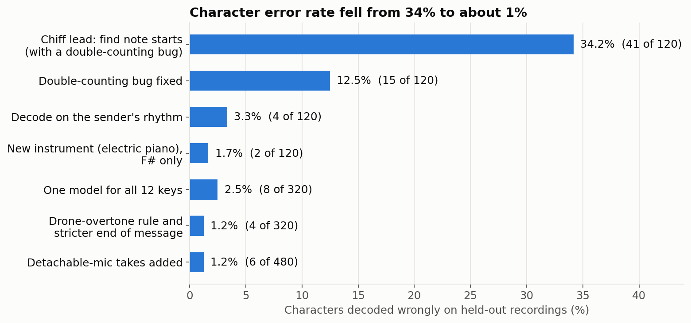
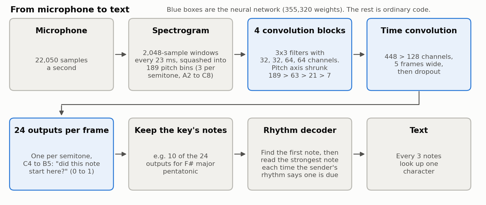
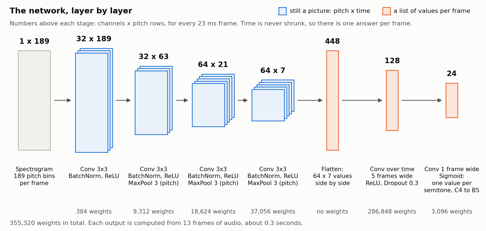
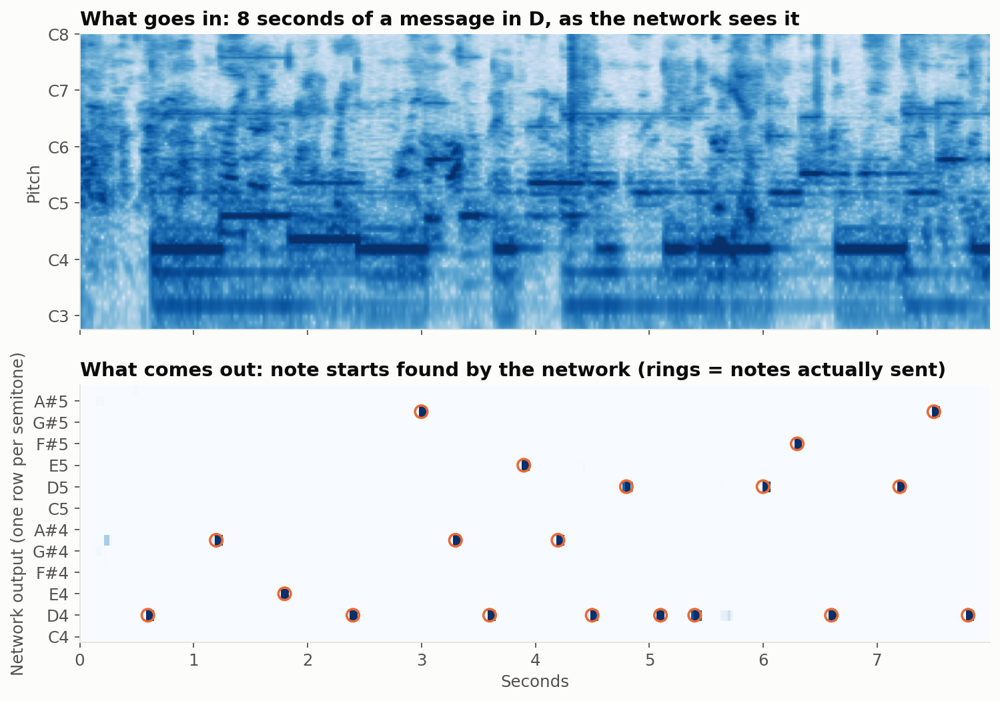
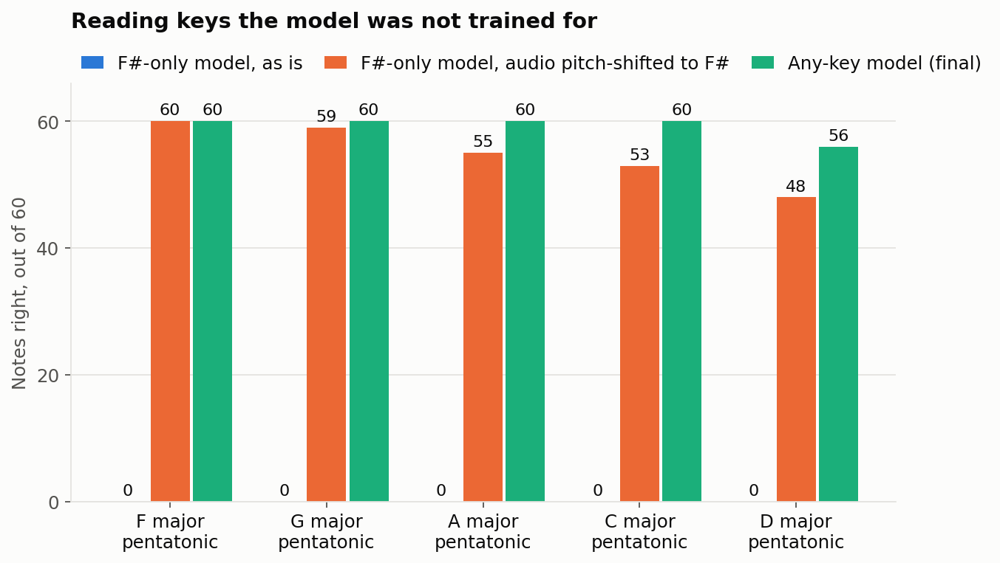
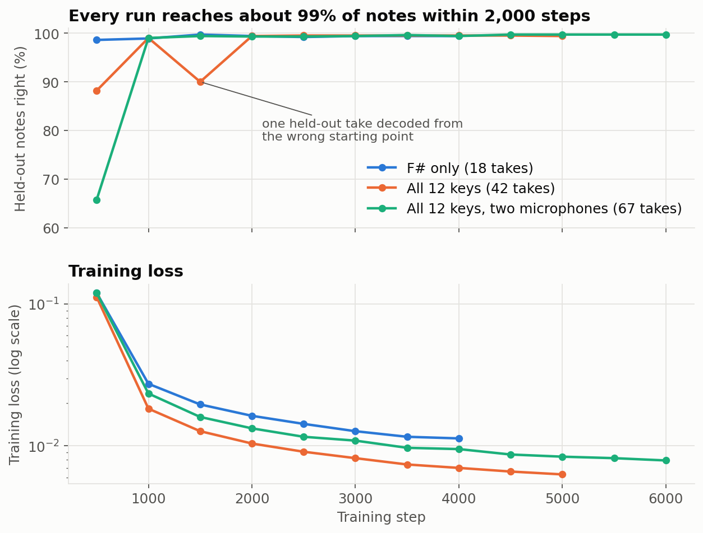

# Receiver devlog: teaching a laptop to read our music

The sender turns text into a melody: every character becomes three notes, played over a
drone. The receiver's job is to listen through a microphone and get the text back. One
misheard note is one wrong character, so "mostly right" is not good enough.

This is the record of how the receiver went from guessing chords to decoding a message
sent through the air from a Mac to a Windows laptop.

Each bar is the share of characters decoded wrongly on recordings the model had never
trained on. The test set grew as we recorded more, so neighbouring bars are not always
the same recordings; the counts beside each bar show how many characters were tested.

## How it works now

Only the middle of the pipeline is a neural network. It answers one narrow question, many
times a second: "did a note start just now, and which one?" Everything after that is
ordinary code that uses what we already know about our own encoding.

The network itself is small. Four convolution stages look for shapes in the spectrogram
and squeeze the pitch axis from 189 rows down to 7, while leaving time untouched. What is
left is flattened into 448 values per frame, and a last convolution looks 5 frames
across time to decide whether a note is starting. Most of the weights (286,848 of
355,320) are in that one layer.

| Part | What we chose | Why |
|---|---|---|
| Input | Spectrogram with 189 bins spaced evenly in pitch, 3 per semitone | Moving a tune up a semitone moves the picture up exactly 3 rows, which lets us fake other keys during training |
| Network | 4 small convolution blocks, then a convolution over time; 355,320 weights | Small enough to train in minutes on a laptop and run live |
| What it sees | About 0.3 seconds around each moment | Enough to tell a note starting from a note still ringing |
| Output | 24 values per frame, one per semitone from C4 to B5 | One model reads every key; the key only decides which outputs we look at |
| Training target | "A note started here", not "a note is sounding" | The sender's notes overlap, so several are always sounding at once |

## What the network actually sees and says

The top picture is 8 seconds of a real recording in the key of D, one the model never
trained on. The dark horizontal bars are notes; the smear underneath is the drone and the
room. The bottom picture is the network's answer. Each dark mark is a note start it found,
and each ring is a note the sender really played. In this stretch every ring has a mark.

## The stages

### 1. Chords and templates (Saturday afternoon)

The first receiver cut the audio into beats and matched each beat against chord shapes.
It worked on clean MIDI files and was far more than we needed. We cut it back to a plain
root-note finder using a Fourier transform, with checks to reject background noise: a
peak had to sit within 30 cents of a real note, and most of the sound's energy had to be
in such peaks.

### 2. Why that was not enough

Then we looked at what the sender really plays. Notes are held long after the next one
starts, and a drone runs underneath, so three to five notes are sounding at almost any
moment. "Which note is sounding?" has several answers at once. The question had to become
"which note just started?", and that is a pattern-recognition job.

### 3. Making our own training data

We control the sender, so we can make as much labelled data as we like. A script picks
random text, encodes it, plays it through the speaker and records the microphone at the
same time. The MIDI file says exactly when each note started, so nothing is labelled by
hand. Every fifth recording is held out for testing and never trained on.

Training mixes in recorded room noise at random levels and changes the volume at random,
so the model does not depend on a quiet room or a fixed distance.

### 4. First model, and a bug that hid a good result

The first model (chiff lead, C minor pentatonic) scored 34% character errors. Looking at
the wrong notes showed the model was not at fault: our code was counting some notes
twice when the model was very sure of them. With that fixed, the same model scored 12.5%.
It never once picked a wrong pitch. Every remaining error was a missed or extra note.

### 5. Using the rhythm

A missed note is worse than a wrong one, because it shifts every group of three after it.
But the sender's rhythm is fixed, so once the first note is found we know when every
later note is due. The decoder stopped hunting for note starts and instead asked the
model "which note is it?" at each due time. Errors fell from 12.5% to 3.3%.

This needed two guards. A stray sound before the message could be taken for the first
note and put every later note in the wrong place, so a start only counts if the next five
notes also arrive on the rhythm. And the message ends when a whole character's worth of
due times is empty.

### 6. A new instrument (Saturday evening)

The team changed the instrument to electric piano, the key to F# major pentatonic, and
shortened the notes. The model only knows the sound it was trained on, so we recorded 18
new messages and retrained: 1.7% character errors.

### 7. One model for every key

The F# model had ten outputs, one per note of that scale, and could not read any other
key. As an experiment we shifted the pitch of recordings in other keys so they lined up
with F#, with no retraining. Keys whose notes all had a matching output (F and G) decoded
almost perfectly. So the model had learned the instrument, not the key, and only failed
on notes it had no output for.

That pointed to the fix: give the model one output for every semitone, record messages in
all 12 keys, and pitch-shift half the training examples up or down a semitone or two. The
result is one model per instrument that reads any key. The key and scale are still told
to the receiver; they decide which outputs it listens to.

The final model's D result (56 of 60) is from a single 20-character message, so treat it
as a spot check.

### 8. The drone was pretending to be a note

Some remaining errors fell on every eighth note, exactly where the drone restarts. A
laptop speaker cannot reproduce the drone's low fundamental, so what the microphone hears
is its overtones, and the loudest one lands exactly on a note of the scale. The decoder
now distrusts that one note at the moments the drone restarts, if another note was heard
clearly. Together with a stricter end-of-message rule, errors went from 2.5% to 1.2%.

### 9. A second microphone, and going live (early Sunday)

For the two-laptop demo we recorded 25 more messages through a detachable USB microphone
and retrained on both microphones together.

All three electric-piano runs behave the same way: a slow start, then about 99% of
held-out notes right by 1,000 to 2,000 steps, with little gained after that. The dip in
the orange line is one held-out recording being decoded from the wrong starting point at
that checkpoint, not the model getting worse.

The first live attempt on the Windows laptop decoded "Yellow" as "5el?". Notes were being
heard, but some were missing. The cause was Windows itself: its microphone "audio
enhancements" treat a held note as background noise and remove it. With that switched
off, the Windows laptop decoded the message in full.

## Final numbers

| Test, on recordings never trained on | Notes right | Character errors |
|---|---|---|
| Detachable microphone, 4 messages | 479 of 480 | 1 of 160 (0.6%) |
| Built-in microphone, 8 messages | 956 of 960 | 5 of 320 (1.6%) |
| Both together | 1,435 of 1,440 | 6 of 480 (1.2%) |

Training data for the final model: 67 recorded messages (8,040 notes) in all 12 keys on
two microphones, plus two recordings of room noise. About 56 minutes of audio in total.

## What we would tell ourselves at the start

- **Look at the errors before changing the model.** The biggest single gain came from a
  bug in our own counting, and the second biggest from decoding differently. Neither
  touched the network.
- **Use what you know about your own signal.** The fixed rhythm, the fixed first note of
  every character and the position of the drone each removed a class of error.
- **Record on the real hardware.** A different instrument, microphone or operating system
  each changed what the model heard.

## Limits

- The numbers above are from one Mac's speakers. The Mac-to-Windows run worked, but we
  only ran a few messages and did not measure an error rate for it.
- Training used the major pentatonic scale only. One message each in D major and A minor
  decoded at 90 of 90 and 85 of 90 notes, which is encouraging and nothing more.
- The receiver has to be told the key and scale. It does not yet work them out itself.
- Chords are not supported, and one misheard note is still one wrong character: there is
  no error correction.

The graphs and diagrams are drawn by `make_graphs.py` in this folder.
